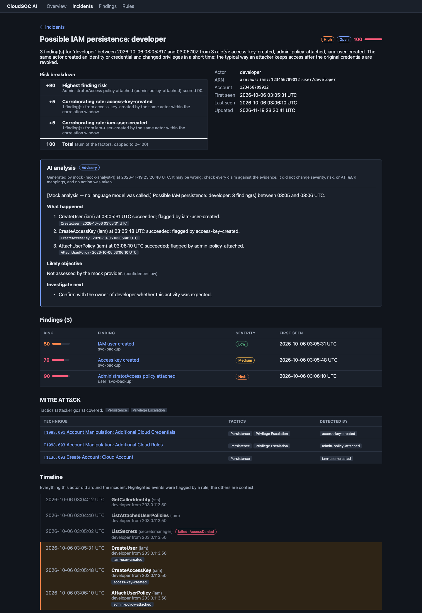
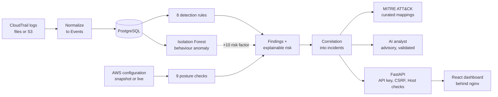
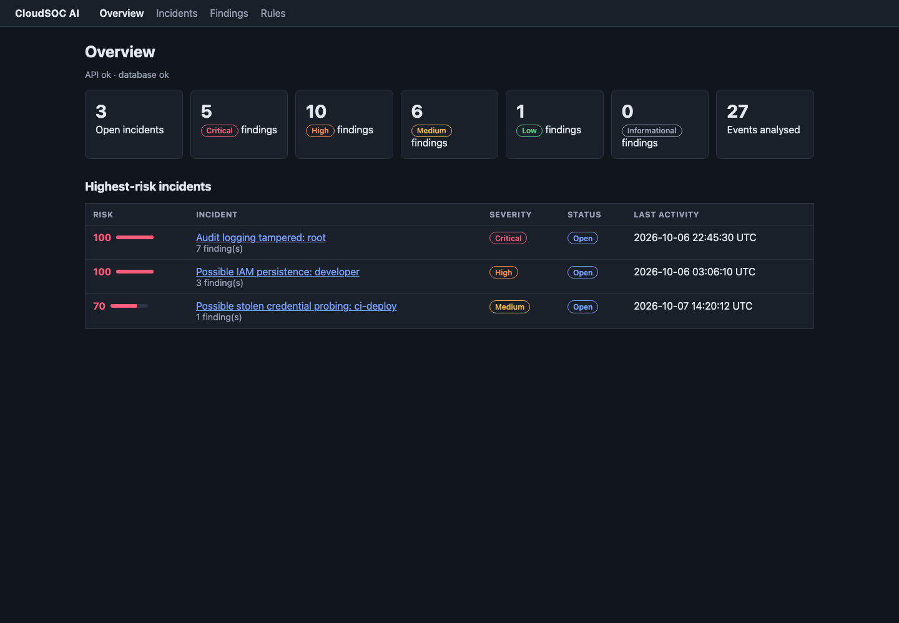
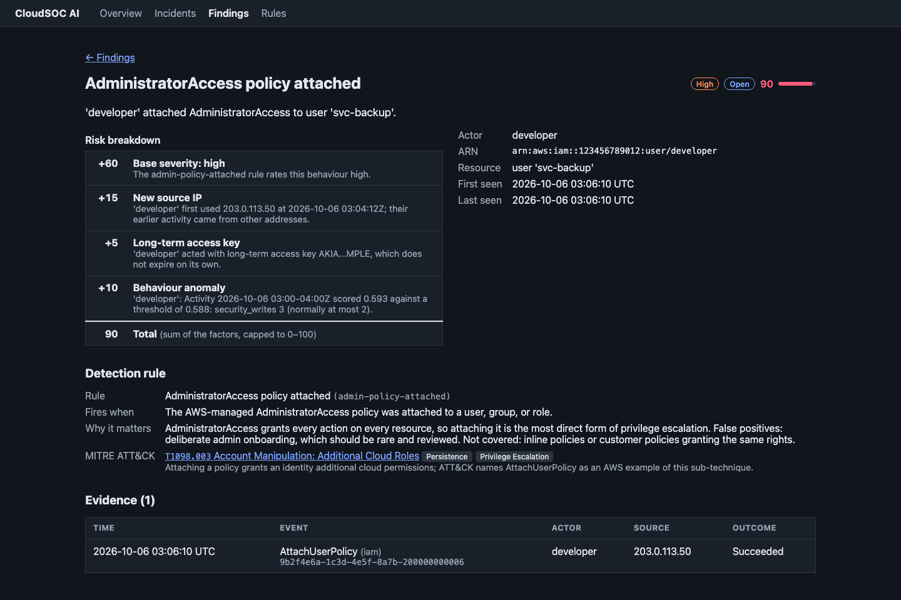
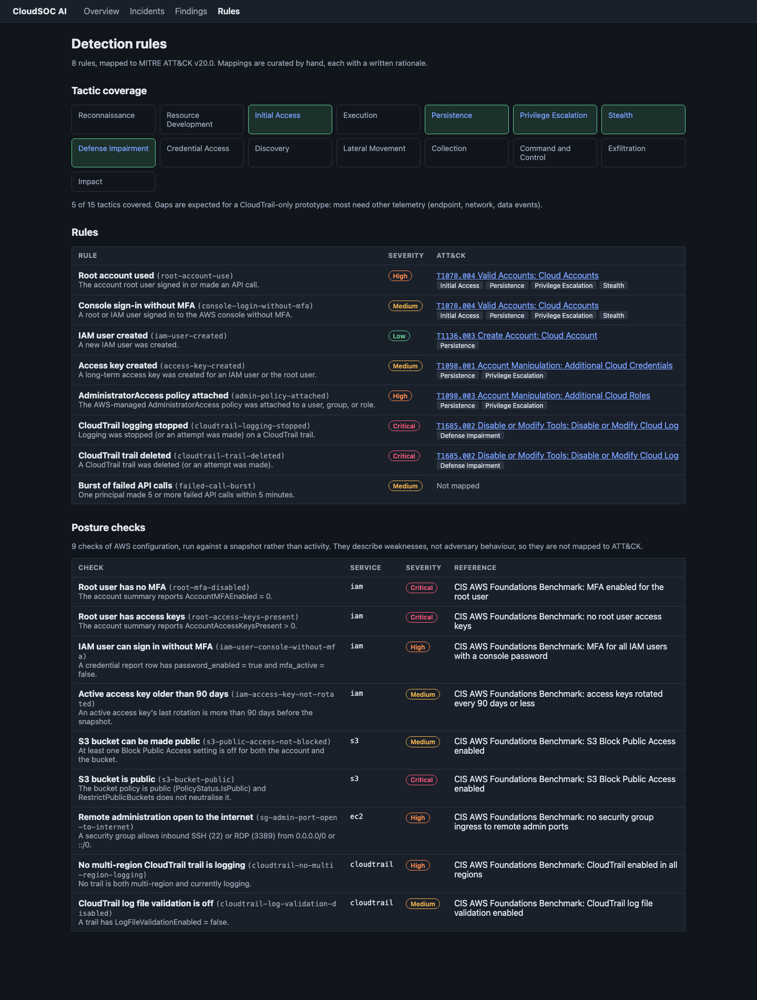
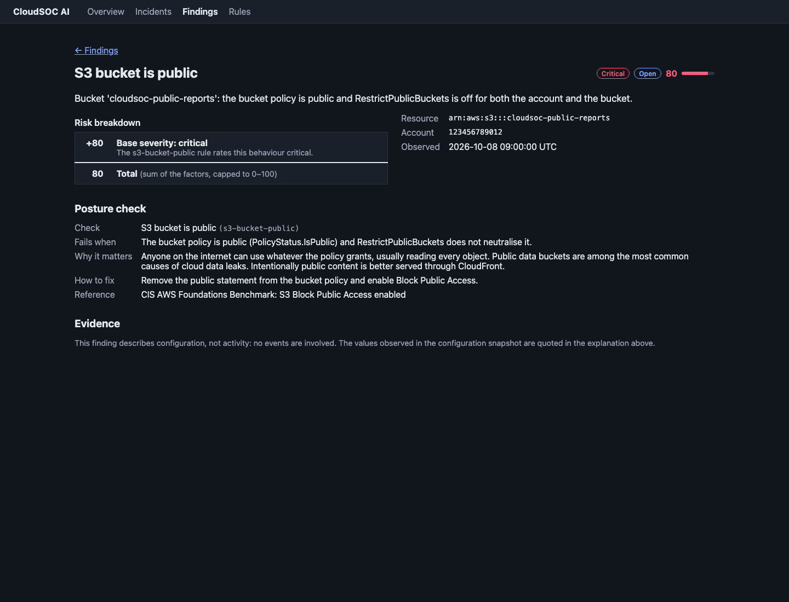

# CloudSOC AI

[](https://github.com/abhay-chauhan25/CloudSocAI/actions/workflows/ci.yml)

A lightweight **AWS security monitoring platform**: a cloud SIEM plus CSPM, with explainable risk scoring, ML behaviour signals, and an advisory AI analyst. Built as a portfolio and learning project.

It reads AWS CloudTrail logs and account configuration, finds suspicious activity and insecure settings, groups related findings into incidents, explains *why* each one scored as it did, and shows it all in a dashboard.

> **Status: portfolio prototype.**
> - **Tested on:** synthetic CloudTrail data and offline (stubbed) AWS calls. The real-AWS path (S3 ingestion, live posture collection, Terraform lab) is built and tested offline, but hasn't yet been run against a live account.
> - **Not production software:** single user, localhost only.



## How it works



**The core design rule: rules and ML detect; the LLM only explains.** The AI analyst can't change a severity, close an incident, or touch AWS. Its answer is schema-validated, and rejected if it cites evidence that isn't there.

| Concept | Meaning | Example |
|---|---|---|
| **Event** | Something happened | `AttachUserPolicy` by `developer` from 203.0.113.50 |
| **Finding** | A detector says it matters, with a decomposable risk score | AdministratorAccess attached: 60 high + 15 new IP + 5 long-term key + 10 anomaly = **90** |
| **Incident** | Related findings that belong together, with a timeline | "Possible IAM persistence": user created, key created, admin attached within one minute |

## Features

| Area | What exists |
|---|---|
| **Ingestion** | Local CloudTrail files and S3 trail buckets (gzip, size- and decompression-capped, read-only IAM). Strict parsing; malformed records are reported, never silently dropped |
| **Detection** | 8 rules (root use, console sign-in without MFA, new user, new access key, admin policy, logging stopped, trail deleted, failed-call burst), each with rationale, false positives, ATT&CK mapping, and positive and negative tests |
| **Risk** | Explainable scores: base severity plus named context factors, validated to sum exactly |
| **ML** | Isolation Forest on per-principal hourly activity, reproducible (seeded) and evaluated. Adds a risk factor, never a finding on its own |
| **CSPM** | 9 CIS-style checks (IAM, S3, EC2, CloudTrail) from a configuration snapshot or a live read-only collector. Missing data is "not evaluated", never "passed" |
| **Correlation** | Same actor within one hour → incident, named by pattern, with a timeline that includes unflagged reconnaissance |
| **MITRE ATT&CK** | Curated v20 mappings with written justification, and a tactic-coverage view showing the gaps |
| **AI analyst** | Gemini or an offline mock. Minimal grounded context, prompt-injection-aware prompt, strict validation, caching, cooldown, daily cap, single-flight lock, full audit log |
| **Dashboard** | Overview, incidents, findings, rules; risk breakdowns, timelines, ATT&CK, AI panel |
| **AWS lab** | Terraform: a multi-region trail, a least-privilege reader role, deliberately insecure but harmless targets, and a guarded scenario generator. Torn down the same day |
| **Delivery** | Docker images (non-root, read-only), Compose stack, and CI covering lint, mypy, tests, dependency audit, Terraform validation, and a full-stack smoke test |

## Quick start (Docker only)

Requirements: **Docker**. No AWS account needed.

```bash
cp .env.example .env                  # set POSTGRES_PASSWORD and API_KEY (instructions inside)
docker compose up -d --build --wait   # database, migrations, API, dashboard
docker compose run --rm seed          # load the synthetic attack data, detect, scan posture
open http://127.0.0.1:8080
```

Then follow the [5-minute demo script](docs/demo.md).

| | |
|---|---|
|  |  |
|  |  |

## Documentation

| Topic | Document |
|---|---|
| Architecture and data model | [architecture.md](docs/architecture.md) |
| Detection rules, ATT&CK mappings, false positives | [detections.md](docs/detections.md) |
| Anomaly detection (features, threshold, evaluation) | [anomaly-detection.md](docs/anomaly-detection.md) |
| Posture checks (CSPM) | [posture-checks.md](docs/posture-checks.md) |
| AI analyst design and threat model | [ai-analyst.md](docs/ai-analyst.md) |
| Reading real logs from S3 | [aws-ingestion.md](docs/aws-ingestion.md) |
| Terraform lab runbook, cost, teardown | [aws-lab.md](docs/aws-lab.md) |
| Containers and local deployment | [containers.md](docs/containers.md) |
| Threat model (STRIDE) | [threat-model.md](docs/threat-model.md) |
| Security review and CI | [security-review.md](docs/security-review.md) |
| CloudTrail field reference | [cloudtrail.md](docs/cloudtrail.md) |

## Tech stack

| Layer | Tools |
|---|---|
| Backend | Python 3.12, FastAPI, Pydantic, SQLAlchemy, Alembic, PostgreSQL 17 |
| ML | scikit-learn (Isolation Forest) |
| AI | Google Gemini (REST), behind a provider interface with an offline mock |
| AWS | boto3 (read-only), Terraform |
| Frontend | React 19, TypeScript (strict), Vite, Vitest |
| Delivery | Docker, Docker Compose, nginx, GitHub Actions |
| Quality | pytest (about 465 tests), Ruff (with security rules), mypy, Vitest (23 tests), pip-audit, npm audit |

## Local development

Requirements: **Python 3.12+**, **Node.js 20.19+**, and **Docker** (for PostgreSQL).

```bash
cp .env.example .env                    # set POSTGRES_PASSWORD and API_KEY
docker compose up -d --wait postgres    # database only, on 127.0.0.1

cd backend
python3.12 -m venv .venv && source .venv/bin/activate
pip install -e ".[dev]"
alembic upgrade head
python -m app.ingest ../sample-data/cloudtrail/*.json   # safe to re-run
python -m app.detect                                     # anomaly scores, rules, risk, incidents
python -m app.posture_scan ../sample-data/aws-config/insecure-account.json
python -m app.ml.evaluate                                # optional: anomaly model evaluation
uvicorn app.api.main:app --reload                        # API on 127.0.0.1:8000; /docs → Authorize with API_KEY
```

In a second terminal:

```bash
cd frontend && npm install && npm run dev   # http://127.0.0.1:5173; the dev proxy adds the API key
```

Real AWS (optional): [aws-ingestion.md](docs/aws-ingestion.md) and [aws-lab.md](docs/aws-lab.md).

### Checks

```bash
# backend/
pytest                 # database tests use a separate *_test database (skipped locally if PostgreSQL is down)
ruff check . && ruff format --check .
mypy

# frontend/
npm run typecheck && npm test && npm run build
```

CI runs all of these on every push, plus dependency audits, Terraform validation, and a Docker smoke test.

## Limitations

- **Data:** synthetic data and stubbed AWS calls. No measurements on real traffic exist yet, so the anomaly model's 5.3% false-positive rate is on a *synthetic* held-out set only.
- **Scope:** CloudTrail management events only. No S3 data events, VPC Flow Logs, or endpoint telemetry, so tactics like Exfiltration aren't covered.
- **Deployment:** single user on localhost. A shared deployment would need SSO and TLS ([threat-model.md](docs/threat-model.md) §6).
- **Ingestion:** batch, not streaming. Posture findings don't auto-resolve when fixed.

## How it was built

Built incrementally in stages: synthetic data, then the MVP pipeline, then ATT&CK and AI, then ML and CSPM, then real AWS and Terraform, then delivery. Each stage was tested, reviewed, and committed separately. [`CLAUDE.md`](CLAUDE.md) holds the development contract and roadmap.

## Security

- Credentials never enter the repository: `.env`, AWS credentials, and Terraform state are gitignored.
- All testing targets synthetic data or infrastructure the developer owns.
